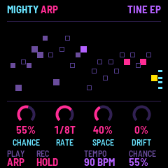
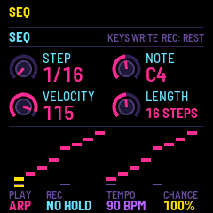
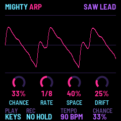

# Mighty Arp for the M-VAVE FM-1

Mighty Arp is custom firmware for the M-VAVE FM-1. It's a 4-op FM and subtractive hybrid synth built around a chance
arpeggiator. You choose the notes, the arp decides when they play. Hold a chord, set CHANCE, and let it create melodies. Plus it has a
32-step sequencer, 50 sounds, chords with strum, swing and humanize, a chorus, a ping-pong delay and a reverb with
shimmer, 16 presets of your own, and MIDI and clock in and out.

  

- **Try it in your browser** (no FM-1 needed): <https://nickculbertson.github.io/FM1-Mighty-Arp/emu/>
- **Install it** (Chrome or Edge, with the FM-1 plugged in): <https://nickculbertson.github.io/FM1-Mighty-Arp/install/>
- **Read the manual**: <https://nickculbertson.github.io/FM1-Mighty-Arp/manual/> (source: [app/docs/MANUAL.md](app/docs/MANUAL.md))
- **Download the firmware file**: [releases](https://github.com/NickCulbertson/FM1-Mighty-Arp/releases)

## Quick start

1. **Hold a chord** on the keys and the arp plays it. Turn **ALGORITHM** for CHANCE (how many steps play) and
   **SELECT** for the tempo.
2. **Turn PRESETS** for another sound: 50 of them, in eight kinds, and RANDOM makes up more.
3. **Press REC** for HOLD, so the arp keeps going after you let go.
4. **Press PLAY** for SEQ: the sequencer runs by itself, and a key transposes it. On the **SEQ** page the keys
   write its steps.
5. **Shape it:** press a page button (ENV, LFO, ARP, FX ...) and turn **KNOB 1–4**. Press it again for its second
   page.
6. **SAVE** keeps how things are for the next power-on. On the sounds page (HOME twice), it saves a USER preset.

Every note the arp and the sequencer play also goes out over USB MIDI, and MIDI notes in play them like the keys.
Mighty Arp also tells the [FM-1 Screen Reader](https://charlesvestal.github.io/fm1-reader/) what its screen shows.

The [manual](app/docs/MANUAL.md) has the rest; [SPEC.md](SPEC.md) is the full design, every page and knob.

## Building and testing

Mighty Arp is an app (`app/`, the sound in `app/dsp/`) on [fm1-base](https://github.com/charlesvestal/fm1-base)
(`base/`, a git submodule); clone with `--recursive`. The toolchain and prerequisites are in
[BUILDING.md](BUILDING.md):

```
./build.sh --host && sh tests/run_tests.sh                   # the app in the simulator: every check
./build.sh                                                   # app/build/mightyarp.fwsc
python3 base/tools/fm1_install.py app/build/mightyarp.fwsc   # install it over USB
```

`app/build/host/mightyarp_host SCRIPT OUTDIR` runs the whole app on a computer from a script (`app/tests/*.txt`),
with screenshots coming out. `./build.sh --web` builds the same code for the browser (the emulator).

Installing it is at your own risk, though it's hard to get stuck: fm1-base's installer can put M-VAVE's own firmware
back, and an FM-1 that fails to start twice comes up in a safe mode the installer can reach.
Mighty Arp keeps its own settings and presets: it does not read other firmwares' projects or samples.

## Credits

Mighty Arp is by Nick Culbertson. The chord voicings are his own, from his Macro MIDI Pad (MacroPicoMIDI); every
sound is made by the engine, with no samples. It is built on [fm1-base](https://github.com/charlesvestal/fm1-base)
by Charles Vestal and [felucca-bsp](https://github.com/hugelton/felucca-bsp), from
[Felucca](https://github.com/hugelton/Felucca) by Leo Kuroshita (Hügelton Instruments). The idea of running FM-1
firmware in the browser comes from [Groove OS](https://www.groove-os.com/). MPL-2.0; see
[LICENSING.md](LICENSING.md).

M-VAVE and FM-1 are trademarks of their owners. Mighty Arp is not affiliated with M-VAVE or Hügelton Instruments.

This project was developed with assistance from Claude Code.
