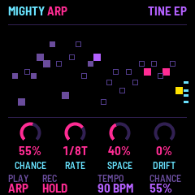
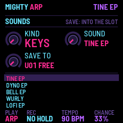

# Mighty Arp

Mighty Arp turns the M-VAVE FM-1 into an FM and analog-style synth built around a chance arpeggiator. You choose
the notes; the arp decides when they play. Hold a chord, set CHANCE, and let it run.

## Install

In Chrome or Edge, connect the FM-1 by USB, open the installer and press Install. Allow MIDI when the browser
asks. Don't unplug it while it writes. From a terminal, in this repository: `python3 base/tools/fm1_install.py mightyarp-VERSION.fwsc`.
The installer can also put M-VAVE's own firmware back. You can try everything first in the browser emulator.

## Playing

Hold notes on the keys (or send them over MIDI) and the arp plays them on the beat. **CHANCE** decides how many
steps actually play: at 100% every step, lower and it thins out into something more like a melody.

| Control | What it does |
| --- | --- |
| PLAY | ARP, SEQ (the sequencer) or KEYS (the keys play the sound directly). |
| REC | Hold: NO HOLD (let go and it stops), HOLD (a new chord replaces the last), LATCH (each key on or off). |
| SELECT | Tempo. |
| ALGORITHM | Chance. |
| PRESET | The sound. |
| OCT− · OCT+ | Octave. |
| MASTER | Volume. |
| K1–K4 | The four knobs of the page on screen. |

## Pages

Each button opens a page for the four knobs. Press it again for its second page.

| Button | Page | Again |
| --- | --- | --- |
| HOME | CHANCE, RATE, SPACE (reverb), DRIFT (vibrato) | SOUNDS: browse and save |
| SEL | SOUND: TONE, STRIKE, DETUNE, VELOCITY | VOICE: poly, mono, legato; GLIDE |
| ENV | AMP ENVELOPE | FILTER, then FILTER ENVELOPE |
| LFO | LFO: RATE, SHAPE, VIBRATO, TREMOLO | LFO 2: PWM, FILTER |
| EDIT | ALGO, RATIO, FEEDBACK, MOD WAVE | OP 1–4: each operator |
| ARP | RATE, OCTAVES, MODE, GATE | CHORDS: CHORD, STRUM, KEY, SCALE |
| SEQ | The sequencer: STEP, NOTE, VELOCITY, LENGTH | GROOVE: HUMANIZE, OCT JUMP, VEL RAND, SWING |
| FX | DELAY | REVERB, then CHORUS |
| GLO | CLOCK, MIDI CH, VEL CURVE, PRESETS (KEEP or CHANGE) | RESETS: PARAMS, FACTORY |

**CHORDS** turns each arp note into a chord in your key and scale (TRIAD, 7TH, LUSH, OPEN), or makes the arp pick
from your chords' notes (the TONES settings). STRUM rolls each chord from low to high.

## The sequencer

Press PLAY until the screen says **SEQ**: the sequence starts from step 1 and runs by itself. A key transposes it from
the next step, and it stays transposed after you let go (the sequence's first note puts it back as written). Press
PLAY again to stop it.

On the **SEQ** page the keys write instead of playing. Each key writes its note at the cursor and moves on, and REC
writes a rest. STEP moves the cursor, NOTE and VELOCITY change its step, and LENGTH sets 1 to 32 steps.

CHANCE, SWING, CHORDS and STRUM work on the steps as they do on the arp. At **GATE 100%**, a step followed by the
same note joins it into one long note.

**On KEYS**, the lower half of most pages shows an oscilloscope of the sound, so you can watch a knob change it.

## Sounds and presets

There are 64 sounds in eight kinds: keys, bells, plucks, bass, leads, pads, percussion and weird (noise and
strange FM textures). Turn PRESET, or press HOME twice for the SOUNDS page.

**Save your own:** on SOUNDS, pick a slot with SAVE TO and press SAVE. A USER preset keeps everything: the sound,
arp, sequence, chords, effects and tempo. It gets a name like FROG MULLET.

**PRESETS** (knob 4 on GLO) decides what changing preset does. On **KEEP**, only the sound changes and your arp and
effects carry on. On **CHANGE**, a USER preset brings back everything it saved, and a factory sound starts from the
default arp, effects and sequence.

**Reset:** press GLO twice for RESETS. Turn PARAMS one click right to RESET: the arp, chords and effects go back to
their defaults; the sound, tempo and your steps stay. FACTORY, turned right to SURE? and then SAVE pressed, puts
everything back as new and deletes every USER preset.

**SAVE on any other page** keeps how things are now for the next power-on.

## MIDI and audio

Notes come in over USB and the TRS jack (MIDI CH: all channels, or one). The arp's and the sequencer's notes go out over
USB. CLOCK: INT runs on its own tempo, OUT sends MIDI clock, EXT follows incoming clock (Start, Stop and Continue
too). Over USB the FM-1 is also a sound
card, named "Mighty Arp FM-1".

## Trouble

**No sound:** turn MASTER up, and check that CHANCE isn't at 0%. On ARP, notes only play while held (or with
HOLD or LATCH).

**It won't start after an install:** put the stock firmware back with the installer, then install again.

---

Mighty Arp by Nick Culbertson. Built on [fm1-base](https://github.com/charlesvestal/fm1-base) by Charles Vestal and
felucca-bsp. MPL-2.0. M-VAVE and FM-1 are trademarks of their owners; Mighty Arp is not affiliated with M-VAVE.
